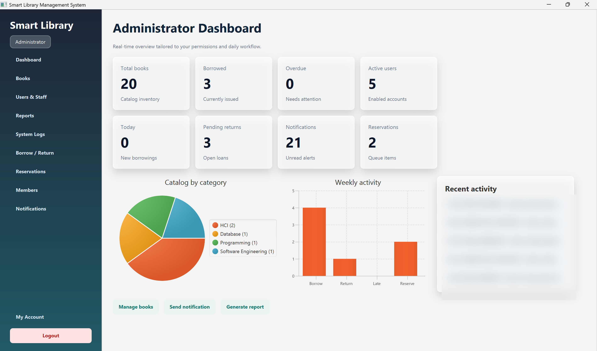
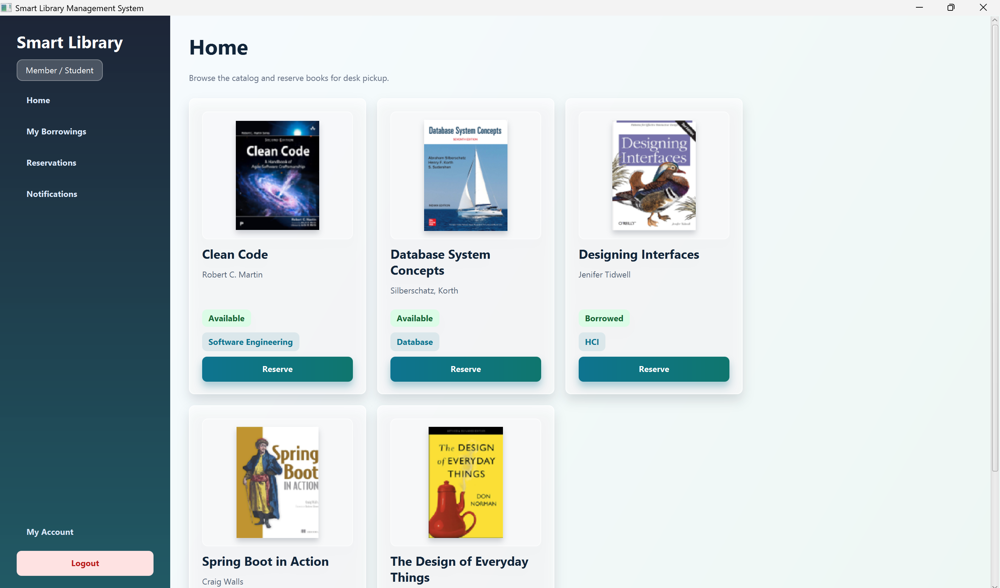
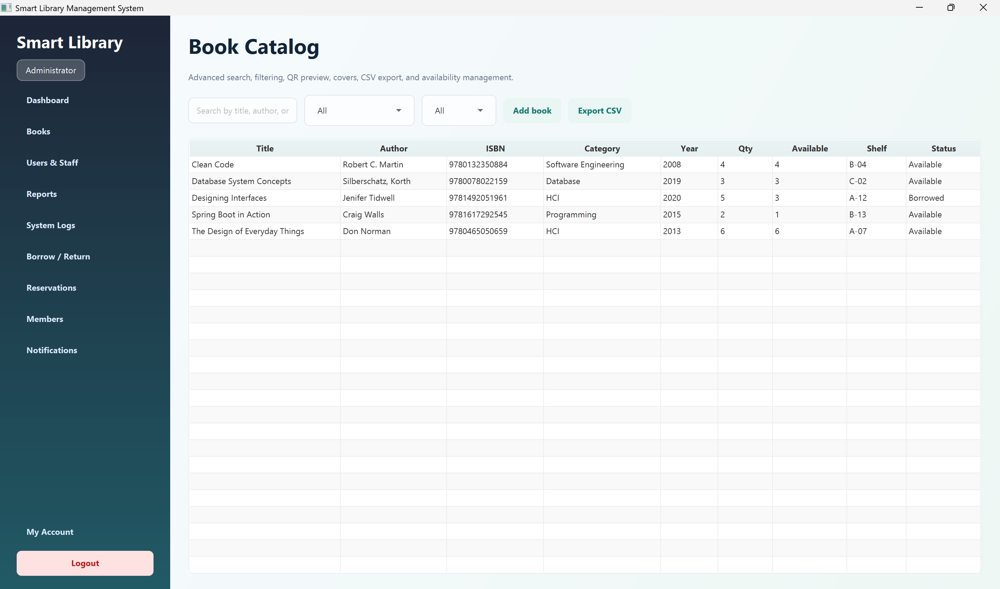
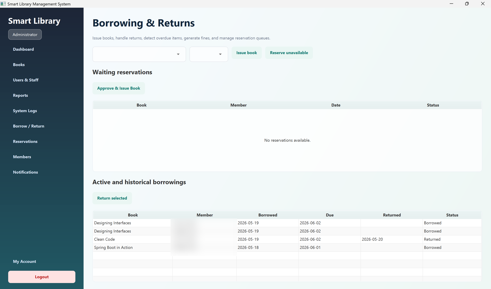
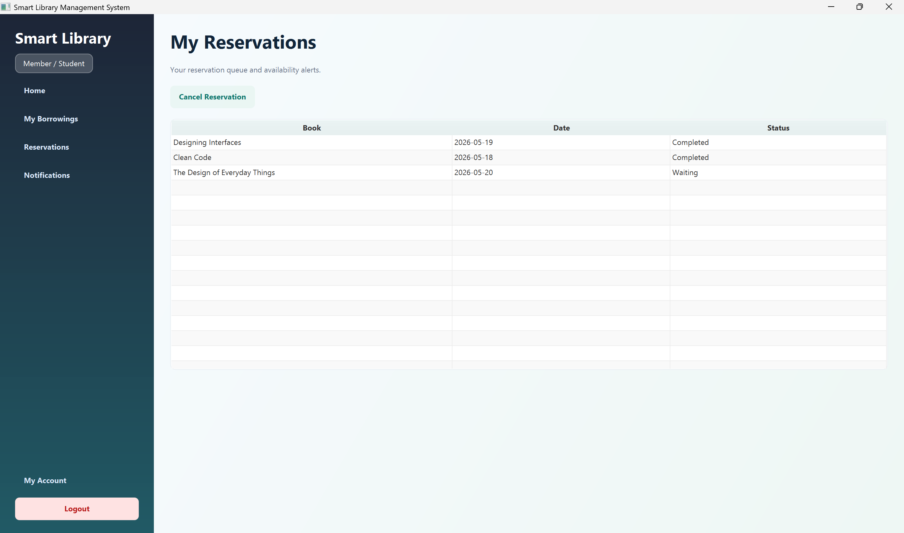
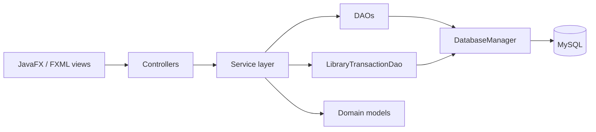
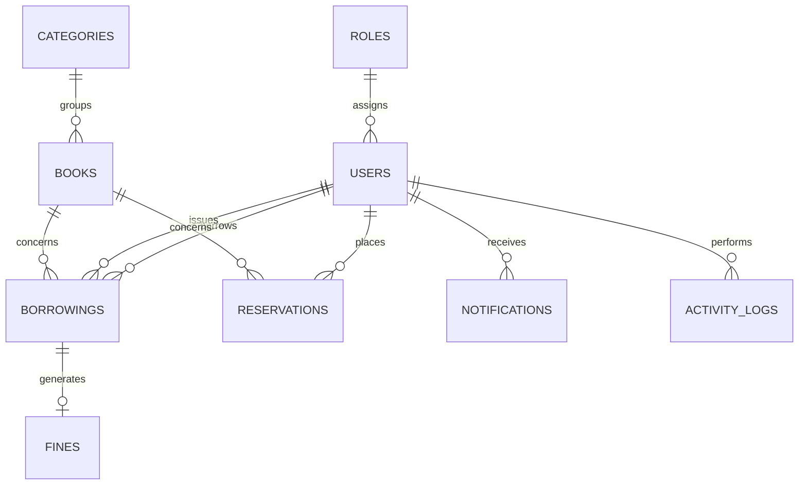

# Smart Library Management System

Smart Library is a JavaFX desktop application for managing a university or school library. It combines a role-based interface with JDBC persistence, transactional circulation workflows and an offline demonstration mode.

Originally developed as an academic group project, it was subsequently hardened and documented for a technical portfolio with transactional JDBC workflows, secure password migration and automated tests.



## Implemented features

- Authentication for administrators, librarians and members.
- BCrypt password hashing with progressive migration of legacy SHA-256 hashes.
- Catalog search, category and availability filters, book management and CSV export.
- Borrowing and return workflows with stock control, duplicate prevention and a three-book limit.
- Fourteen-day due dates, overdue detection and automatic daily fines.
- Member reservation queue, cancellation and librarian/admin approval.
- User activation, profile management and role-aware administration.
- Dashboard statistics, notifications, activity logs and project reports.
- Demo mode when MySQL is unavailable; persistence-only actions remain disabled.

## Application gallery

| Member catalog | Catalog management |
|---|---|
|  |  |

| Borrowing and returns | Member reservations |
|---|---|
|  |  |

The screenshots were captured from the running JavaFX application. User-identifying table and activity data has been obscured where necessary.

## Technology stack

- Java 17
- JavaFX 21 and FXML
- Maven
- JDBC with MySQL Connector/J 8.4
- MySQL 8 / WAMP-compatible MySQL
- JUnit 5
- BCrypt (`jBCrypt`)

## Architecture

The application follows an MVC-style layered structure. Controllers handle JavaFX interaction, services enforce validation and authorization, and DAOs isolate JDBC persistence.



Important operations such as borrowing, returning a book, creating a fine and updating the reservation queue are committed or rolled back as one database transaction.



Detailed, code-aligned diagrams are available in [`docs/architecture`](docs/architecture).

## Prerequisites

- JDK 17
- Maven 3.9+ or the Maven installation bundled with IntelliJ IDEA
- MySQL 8+ or WAMP/MySQL

## Database setup

1. Start MySQL.
2. Execute [`src/main/resources/sql/schema.sql`](src/main/resources/sql/schema.sql).
3. Copy [`database.properties.example`](database.properties.example) to `database-local.properties` in the project root.
4. Enter the local database user and password in `database-local.properties`.

`database-local.properties` is ignored by Git and must never be committed.

Configuration precedence is:

1. JVM properties: `smartlibrary.db.url`, `smartlibrary.db.user`, `smartlibrary.db.password`
2. Environment variables: `SMART_LIBRARY_DB_URL`, `SMART_LIBRARY_DB_USER`, `SMART_LIBRARY_DB_PASSWORD`
3. Local file: `database-local.properties`
4. Safe defaults for `localhost`, database `smart_library`, user `root` and an empty password

## Run the application

```bash
mvn clean javafx:run
```

In IntelliJ IDEA, import the project as Maven, select JDK 17 and run `com.smartlibrary.MainApp` or the Maven goal `javafx:run`.

Demo accounts created by the supplied SQL schema:

| Role | Email | Initial password |
|---|---|---|
| Administrator | `admin@library.edu` | `admin123` |
| Librarian | `librarian@library.edu` | `lib123` |
| Member | `student@library.edu` | `student123` |

Change demonstration credentials before using the application outside a local academic environment.

## Tests and packaging

```bash
mvn clean test
mvn package
```

The automated suite covers borrowing rules, stock availability, duplicates, returns, fines, reservations, role authorization, BCrypt and legacy SHA-256 compatibility. JDBC transaction verification requires a separate disposable MySQL database; see [`docs/testing-guide.md`](docs/testing-guide.md).

The generated JAR is written to `target/`. Maven `javafx:run` remains the recommended way to launch the application because JavaFX dependencies are managed by Maven.

## Project structure

```text
src/main/java/com/smartlibrary/
  controller/   JavaFX screen controllers
  model/        Domain models
  service/      Business rules and authorization
  dao/          JDBC persistence and transactions
  util/         Session, password and UI helpers
src/main/resources/
  fxml/         JavaFX views
  css/          Application styling
  sql/          MySQL schema and demonstration data
src/test/java/  JUnit 5 tests
database/       Database design material
uml/            UML diagrams
docs/           Installation, testing and publication guides
```

## Security notes

- Passwords are stored with BCrypt; valid legacy SHA-256 hashes are upgraded after successful authentication.
- Database credentials stay outside version control.
- Service methods enforce critical role checks independently of JavaFX navigation.
- The project previously contained a MySQL password in Git history. Rotate that credential and publish from a clean history by following [`docs/github-publication-checklist.md`](docs/github-publication-checklist.md).

## Academic documentation

Requirements, UML diagrams, database models and installation material are available in `requirements/`, `uml/`, `database/` and `docs/`.
