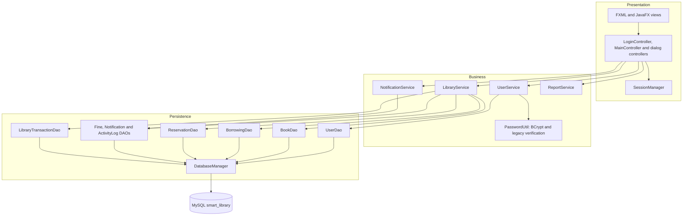
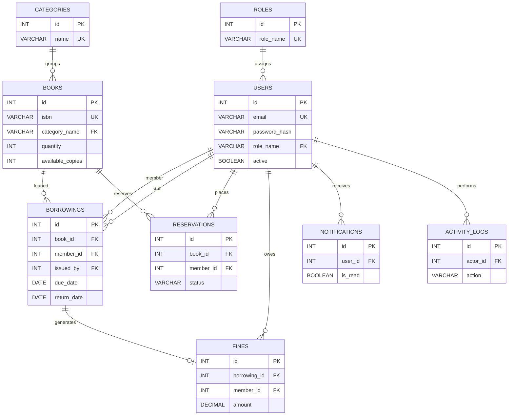

# Architecture

These diagrams reflect the current Java packages and SQL schema. They intentionally omit UI widgets and routine CRUD methods to keep the system structure readable.

## Application layers

`LibraryTransactionDao` owns the multi-table borrowing and return transactions. `BorrowingDao` retains the atomic reservation approval workflow. Service methods update in-memory state only after database success or restore it after rollback.

## Relational model

The authoritative schema is [`../../src/main/resources/sql/schema.sql`](../../src/main/resources/sql/schema.sql).
